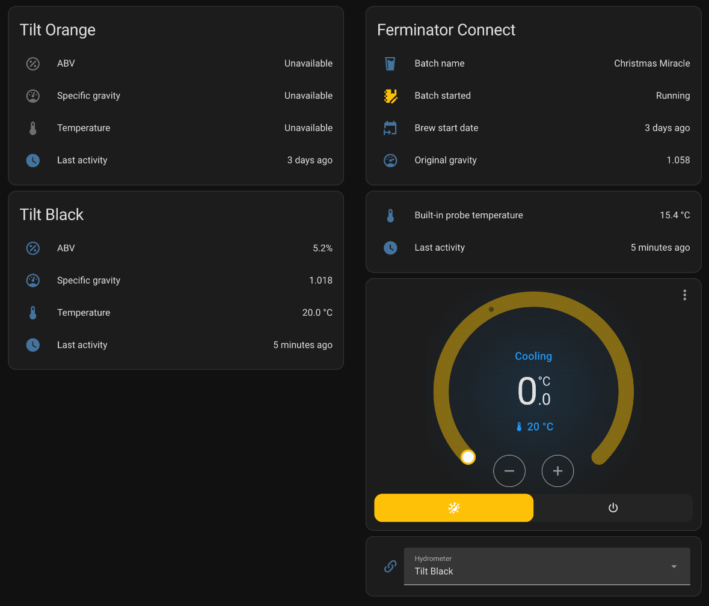

# BrewCreator integration for Home Assistant
[](https://github.com/bjorncs/ha-brewcreator/actions/workflows/ci.yml)

Monitor and control your devices in [BrewCreator](https://brewcreator.com) such as
[Fercubator Connect](https://www.brewolution.com/fermentation/fercubator-and-accessories/fercubator-connect-wifi-thermostat-controlled-fermentation)
(previously named Ferminator Connect) through Home Assistant.



## Installation
The integration needs Home Assistant 2026.11 or later, and is installed through the Home Assistant Marketplace.

[](https://my.home-assistant.io/redirect/marketplace_repository/?owner=bjorncs&repository=ha-brewcreator&category=integration)

Or add it by hand: go to *Settings → Marketplace*, select *Add from link*, enter `bjorncs/ha-brewcreator` and select
*Add*. If you're asked for the type, choose *Integration*. See
[Custom repositories](https://www.home-assistant.io/integrations/marketplace/#custom-repositories) in the Marketplace
documentation.

## Supported devices
- Fercubator Connect / Ferminator Connect
- Tilt hydrometer
- Graviator hydrometer

Create your account at [brewcreator.com](https://brewcreator.com); everything else can be done from Home Assistant.

**Register every device in BrewCreator**, including each Tilt colour you use. To add or remove one, go to the
integration and select *Configure*. A Ferminator or Graviator is added by the serial number printed with its QR code,
and must be switched on and connected to Wi-Fi; a Tilt is added by its colour. Devices registered in the web app
appear in Home Assistant automatically too, and one account can have several hydrometers. If you select a Tilt
colour in the Ferminator Connect's own menu that isn't registered, BrewCreator logs its readings under the Tilt
already linked to the Ferminator.

Removing a device removes it from your BrewCreator account, and its device and entities from Home Assistant. It is
unlinked first if it is linked.

A Ferminator's Hydrometer select changes which Tilt or Graviator is linked to it, like Connect Device in the
BrewCreator web app.

A Ferminator's climate entity reports the linked hydrometer's temperature when it has a reading, and the
Ferminator's built-in probe otherwise.

## Batch info
A Ferminator's batch info (name, owner, beer style, OG, FG, EBC, IBU, volume, fermentation type and whether the
brew is started) is shown as sensors and changed with the `brewcreator.set_batch_info` action. Only the fields you
give are changed. The action works from the UI, scripts, automations and AI assistants that can call Home
Assistant actions. For example, to start a new batch:

```yaml
action: brewcreator.set_batch_info
data:
  device_id: <your Ferminator's device ID>
  batch_name: Christmas Miracle
  beer_style: Scottish Export
  original_gravity: 1.058
  final_gravity: 1.015
  started: true
```

To clear fields, list them in `clear`. Every field except `started` can be cleared, for example to remove the
previous batch's details before the next brew:

```yaml
action: brewcreator.set_batch_info
data:
  device_id: <your Ferminator's device ID>
  clear: [batch_name, original_gravity, final_gravity]
```

## Assist and AI assistants
The integration gives LLM conversation agents (Google Gemini, OpenAI, Anthropic, Ollama, …) tools when they use the
Assist API (*Device control*). MCP clients get them too, through Home Assistant's MCP Server integration:

| Tool | What it does |
|------|--------------|
| `brewcreator__GetFermentationStatus` | Batch info, temperatures, specific gravity, ABV and days fermenting of a Ferminator or hydrometer |
| `brewcreator__SetBatchInfo` | Changes the batch info of a Ferminator or unlinked Graviator, like the `brewcreator.set_batch_info` action |
| `brewcreator__LinkHydrometer` | Links a hydrometer to a Ferminator, or unlinks it |

The tools are the intents `BrewCreatorGetFermentationStatus`, `BrewCreatorSetBatchInfo` and
`BrewCreatorLinkHydrometer`, which can also be handled through Home Assistant's intent API.

An agent only sees Ferminators and hydrometers that have at least one entity exposed to Assist. The
Ferminator's climate entity is exposed by default. To expose the others, go to *Settings → Voice assistants →
Expose*. The built-in intents also work on that climate entity, for example "set the Ferminator to 12 degrees".

## Quiet regulation (reduce fan noise)
The Ferminator's fan runs whenever temperature regulation is on, also while it is neither cooling nor heating.
The *Ferminator quiet regulation* blueprint turns regulation off while the beer is close to its target temperature.

[](https://my.home-assistant.io/redirect/blueprint_import/?blueprint_url=https%3A%2F%2Fgithub.com%2Fbjorncs%2Fha-brewcreator%2Fblob%2Fmain%2Fblueprints%2Fautomation%2Fbjorncs%2Fferminator_quiet_regulation.yaml)

Use *Re-import blueprint* on the blueprint to get later updates.

Turn the automation off to change regulation by hand.

### Smooth the temperature first
The hydrometer temperature that BrewCreator reports can vary by several tenths of a degree between readings. Acting
on single readings could switch regulation on and off far too often. Instead, create a
[Statistics helper](https://my.home-assistant.io/redirect/config_flow_start/?domain=statistics) over the
hydrometer's Temperature sensor with:

- Name: *Beer Temperature*. Home Assistant adds the helper to the hydrometer's device and puts the device name in
  front, so with a Tilt Black this gives *Tilt Black Beer Temperature* (`sensor.tilt_black_beer_temperature`).
- Characteristic: *Average step* (`average_step`). It weighs each value by how long it lasted.
- Max age: 30 minutes.
- Keep last sample: on.

Then select the helper as the blueprint's *Beer temperature*. If you leave it empty, the blueprint uses the
Ferminator climate entity's current temperature as is.

### Inputs
| Input | Default | Description |
|---|---|---|
| Ferminator | | The Ferminator's climate entity. |
| Beer temperature | *(none)* | The smoothed temperature. Empty uses the climate entity's current temperature. |
| Off threshold | 0.5 | Turn regulation off when the beer is at most this far from the target. |
| On threshold | 1.0 | Turn regulation on when the beer is at least this far from the target. Must be larger than the off threshold. |
| Minimum time between switches | 15 min | Leave regulation on or off for at least this long after it was last switched, by the blueprint or by hand. |

Temperatures and thresholds are in your Home Assistant temperature unit.

## Contributing
Feel free to make an issue or a pull request.
Please attach [diagnostics output](https://www.home-assistant.io/docs/configuration/troubleshooting/#download-diagnostics) and relevant log if you're reporting an issue (make sure to
[enable debug logging](https://www.home-assistant.io/docs/configuration/troubleshooting/#enabling-debug-logging) prior to dumping the log).

### Development
The tests run against the Home Assistant version in `requirements.txt`. `requirements_dev.txt` adds the lint and type
check tools:

```bash
uv venv --python 3.14 .venv && uv pip install --python .venv/bin/python -r requirements_dev.txt
.venv/bin/python -m unittest discover -s tests
```

[pre-commit](https://pre-commit.com) runs ruff (lint and format), codespell, JSON/YAML checks and mypy. Install it as a
git hook to run it on every commit, or run it on all files:

```bash
uv run --no-project pre-commit install
uv run --no-project pre-commit run --all-files
```

CI runs the same checks, the tests, and Home Assistant's hassfest and HACS validation on every pull request and push
to `main`.

`tests/test_api.py` runs against the BrewCreator cloud, and is skipped unless `BREWCREATOR_USERNAME` and
`BREWCREATOR_PASSWORD` are set.

[docs/brewcreator-api.md](docs/brewcreator-api.md) collects what has been observed about the BrewCreator API: what
its fields mean, timings and quirks.

# License
This work is licensed under the Apache License 2.0. See [LICENSE](LICENSE) for more information.
