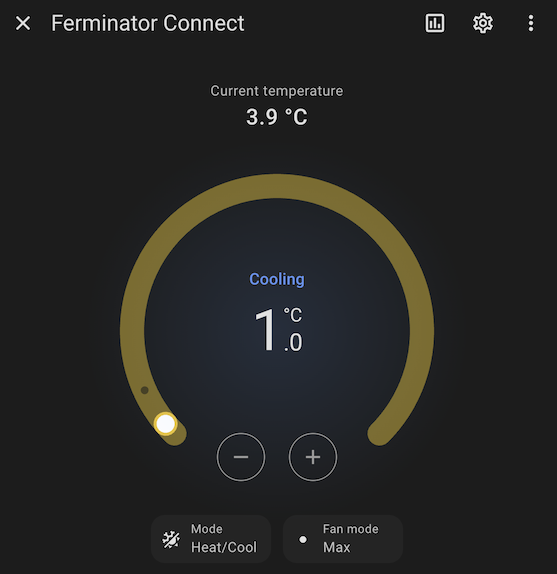

# BrewCreator integration for Home Assistant
Monitor and control your devices in [BrewCreator](https://brewcreator.com) such as
[Fercubator Connect](https://www.brewolution.com/fermentation/fercubator-and-accessories/fercubator-connect-wifi-thermostat-controlled-fermentation)
(previously named Ferminator Connect) through Home Assistant.



## Supported devices
- Fercubator Connect / Ferminator Connect
- Tilt hydrometer
- Graviator hydrometer

Several hydrometers can be registered on one BrewCreator account. Devices added to BrewCreator appear in
Home Assistant automatically, without reloading the integration, and devices removed from BrewCreator are disabled.

A Ferminator's Hydrometer select changes which Tilt or Graviator is linked to it, like Connect Device in the
BrewCreator web app.

## Batch info
A Ferminator's batch info (name, owner, beer style, OG, FG, EBC, IBU, volume, fermentation type and whether the
brew is started) is shown as sensors and changed with the `brewcreator.set_batch_info` action. Only the fields you
give are changed, so it works from the UI, scripts, automations and AI assistants that can call Home Assistant
actions. For example, to start a new batch:

```yaml
action: brewcreator.set_batch_info
data:
  device_id: <your Ferminator's device ID>
  batch_name: Christmas Miracle
  beer_style: Scottish Export
  original_gravity: 1.058
  final_gravity: 1.015
  started: true
```

The final gravity must be below the original gravity. Version 1.0.0 replaces the batch options dialog and the
Batch Started switch, Batch Name text and OG/FG number entities with this action and read-only sensors.

## Installation
[](https://my.home-assistant.io/redirect/hacs_repository/?owner=bjorncs&repository=ha-brewcreator&category=integration)
- Use [HACS](https://www.hacs.xyz/docs/use/) to install the integration through the Home Assistant UI.
  Select [Custom Repositories](https://www.hacs.xyz/docs/faq/custom_repositories/) and use repository `bjorncs/ha-brewcreator` with type `Integration`.

## Contributing
Feel free to make an issue or a pull request.
Please attach [diagnostics output](https://www.home-assistant.io/docs/configuration/troubleshooting/#download-diagnostics) and relevant log if you're reporting an issue (make sure to
[enable debug logging](https://www.home-assistant.io/docs/configuration/troubleshooting/#enabling-debug-logging) prior to dumping the log).

# License
This work is licensed under the Apache License 2.0. See [LICENSE](LICENSE) for more information.